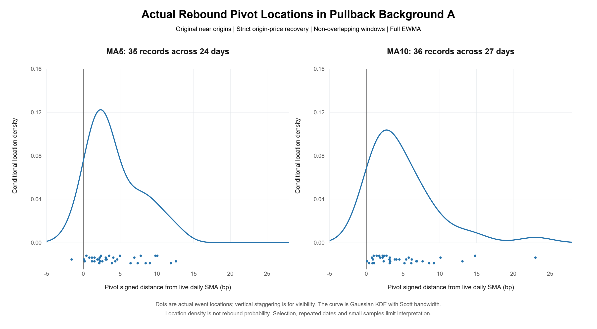
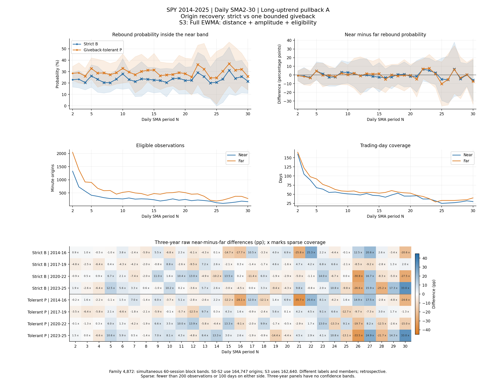

# Successful rebound locations near daily moving averages

## Question and mathematical approach

Can a successful rebound begin before price reaches a familiar daily moving average, and do familiar periods such as MA5 and MA10 behave differently from nearby periods? Investors anticipating others' early actions is one possible motivation. The [model background](docs/early_model/typeset/main.tex) expresses that idea through beliefs, a capture-versus-entry-cost trade-off and a best-response fixed point. The conditions for existence, local stability and comparative statics are explicit. Price shapes alone do not validate the model, and an empirical pivot is not a trader's choice or an estimated equilibrium distance.

The final empirical task is to define the approach and sustained reaction consistently, then inspect the locations of successful events. MA5 versus MA4/6, MA10 versus MA9/11 and longer-period differences remain comparison questions, not assumed advantages.

## Data and current measurement

The analysis uses genuine locally cached IBKR HMDS SPY one-minute regular-session TRADES closes. The final comparison period is **2014–2025**, also summarized in four three-year blocks. These historical years were previously inspected; none is claimed as a pristine holdout. Prices are vendor closes, not a newly constructed dividend-reinvested total-return series. No market data were generated for these observations or downloaded for this review.

The live daily average is

$$M_{N,t}=\frac{P_t+\sum_{k=1}^{N-1}C_{t-k}}{N},\qquad d_{N,t}=10{,}000\left(\frac{P_t}{M_{N,t}}-1\right).$$

Here the C values are reliable completed daily closes, not preceding minute prices. Positive signed distance is above the line; 1 bp is 0.01%. Each pivot distance uses the live average at that pivot's timestamp.

| Component | Frozen final rule |
| --- | --- |
| Bullish-pullback A | Previous completed day's EMA50 > EMA200 and EMA20 ≤ EMA50 |
| Downward approach | Origin close strictly below each of the preceding five minute closes; five-minute decline at least b0 |
| Full EWMA scale | Weighted root mean square of 60 past completed same-session minute log returns in bp, excluding the origin's current return; half-life 20 minutes |
| Magnitude | b0 = max(2 cents, ceil(origin price in cents × sigma_bp / 10,000)); frozen for that origin's outcome window |
| Original near / far | Origin z = signed bp / (sigma × sqrt(5)); near 0 < z ≤ 1, far 1 < z ≤ 3 |
| Strict origin-price reaction B | Within the next five minutes, three consecutive closes each at least origin price + b0 |
| Observed pivot | Last tied lowest close before the first qualifying three-close window begins; not the minimum of the whole future window |
| Non-overlap for location plots | In each session, retain the earliest eligible origin and suppress the following five minutes; repeat without consulting outcomes or the chosen MA |

The same-session history and a complete five-minute outcome window are required. Incomplete windows are not counted as failed rebounds. Origin features use past information; future prices label outcomes and pivots only. Pivot time is constrained by the detector and is not an identified instant of investor action. Full EWMA is the final S3 configuration in the saved tables.

## Final observed locations

The main scatter restricts the non-overlap sample to background A, original-near origins and strict origin-price successes. These are actual event records, not points interpolated from summary quantiles.

| Group | Eligible non-overlap origins | Successful records / days | Pivot median bp | Pivot 25th–75th percentiles bp | No close passage within five minutes |
| --- | ---: | ---: | ---: | ---: | ---: |
| MA5 | 152 | 35 / 24 | +3.0473 | [+1.7148, +6.6751] | 34 / 35 |
| MA10 | 112 | 36 / 27 | +3.2260 | [+1.8556, +6.3369] | 36 / 36 |

Most of these successful-event pivots lie above their live MA. One MA5 pivot is below it and remains included. For that event, the observed low and first close passage occur at the same close, with confirmation later; intraminute ordering is unknown. There is no close passage in the other listed events, which does not exclude an intraminute touch. Different MA groups can describe the same market episode; the 71 records are not 71 independent swings.

Horizontal point locations are observed values; vertical staggering only makes them visible. Gaussian KDE uses h = sample standard deviation × n^(-1/5), fixed once per group under Scott's rule. It is a conditional event-location density, not a confidence band or rebound probability. Gaussian tails can extend beyond observed points; a positive median neither identifies the mode nor proves a displaced population peak.

## Probability comparisons and uncertainty remain essential

Location plots condition on success. To ask whether proximity changes success probability, eligible origins including non-reactions must form the denominator. The saved landscape uses its full origin population; its rates are not the non-overlap scatter group's rates.

| Full-EWMA MA5 origin-price comparison | Strict near-minus-far gap (percentage points) | Tolerant gap (percentage points) |
| --- | ---: | ---: |
| No background filter | −0.4754 | −0.9716 |
| Bullish-pullback A | +4.6580 | +4.5448 |
| Long-uptrend C | −0.8413 | −1.2839 |

C means the prior close is above SMA200 and SMA200 exceeds its value 20 sessions earlier. It is not interchangeable with A. The tolerant outcome allows one limited giveback in a three-close window: at least two closes including the last clear b0, and all three clear ceil(b0/2). A second anchor uses the running low known before the qualifying window begins. These alternatives remain in the complete final sensitivity tables, without selecting only favorable definitions.

The saved joint family contains **4,872 comparisons** across MA2–MA30, backgrounds, anchors, reaction rules and scale/eligibility configurations or their changes. All **1,392 native full-period near-minus-far gaps** include zero under both 20- and 60-session-block simultaneous intervals (999 shared draws per block setting). For example, the A strict MA5 gap of +4.6580 pp has a 60-session simultaneous half-width of 10.5626 pp. A positive point estimate is not a confirmed advantage.

A retained adverse sensitivity result is the A MA14 strict gap's approximately −3.13 pp change when reaction magnitude is rescaled: its change interval excludes zero under 60-session blocks but not 20-session blocks. The result is block-sensitive. The complete saved family is retained so this scope reduction does not conceal current negative results or shrink the comparison family after inspection.

## Interpretation and limits

The final contribution is an inspectable distribution of successful-event pivots under explicit conditions, alongside denominator-based comparisons. It does not establish investor psychology, causal support, a stable MA-specific advantage, an equilibrium anticipation distance or profitable execution. No five-minute clock restarted at first contact was evaluated here.

Small background-specific samples, changing membership across MA periods, overlapping outcomes in the full landscape, dependence across days, nonstationarity and prior definition exploration limit inference. The block comparisons address some dependence but do not remove these concerns. Four-period summaries remain retrospective stability checks. Uncertainty spanning zero is not proof that every form of the motivating hypothesis is absent.

## Sources and reproducibility

This note reorganizes frozen final tables and the completed bull-side report without new empirical calculations. [PROVENANCE.json](PROVENANCE.json) identifies the retained sources by path and hash, including source reports kept outside this candidate. The underlying data source is documented above; raw bars, vendor prices, large caches and credentials are excluded.

The [review verifier](scripts/verify_review.py) checks current event counts, dates, quantiles, passage totals, the quoted final probability points, interval-family counts, links and delivered hashes. It does not call the retired core verifier or certify the underlying estimators. Some final calculations ran in interactive memory sessions, and a complete portable market-to-results runner has not been certified. See [REPRODUCIBILITY.md](REPRODUCIBILITY.md). The user directed the research with AI assistance in execution and presentation. No new experiments, broker operations, trades or publication were performed for this edition.
