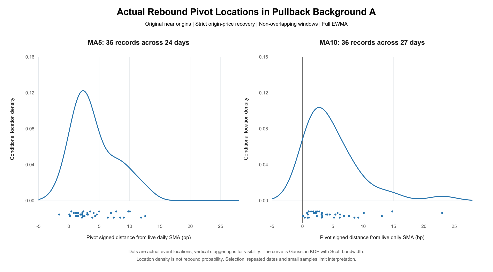

# Where do successful rebounds begin relative to daily moving averages?

**Research portfolio for professional review — local candidate, not uploaded.**

Investors may regard familiar daily averages such as MA5 and MA10 as support. If they anticipate others acting early, a rebound might start before contact. The mathematical approach makes this idea discussable through choices, beliefs, payoff trade-offs and a best-response fixed point. It is a motivating hypothesis, not an identified mechanism.

The empirical contribution is a precise measurement: after fixing the market background, downward approach and sustained-rebound definition, extract each successful event's actual pivot and locate it relative to its contemporaneous live daily MA.

Under the frozen bullish-pullback A, original-near, full-EWMA, strict origin-price and non-overlap rules, **MA5 has 35 records across 24 days; MA10 has 36 across 27 days**. Median pivot distances are **+3.05 and +3.23 bp**. Respectively, 34/35 and 36/36 successful events have no close passage during the five-minute observation window. Most observed pivots are above the line; the actual cross-line MA5 point is retained.



This describes **location conditional on a successful rebound**, not rebound probability conditional on location. Positive medians do not establish a density mode, a special anticipation region, strategic behavior or profitability. The accompanying probability comparisons retain negative and uncertain results: stable MA-specific superiority has not been established.

## Read these two items

1. [Mainline review note](MAINLINE_REVIEW.md): current definitions, data, final observations, comparison results and limitations.
2. [Mathematical model background — LaTeX source](docs/early_model/typeset/main.tex): the researcher's approach with explicit mathematical clarifications. This edited edition preserves the model and abbreviates retired measurement rules; it is not an uncorrected full transcription. The built-in editor compiled it successfully; no standalone PDF has been exported.

## Inspect and verify

Selected research decisions are made inspectable rather than asserted as skills:

- **Formalize the intuition:** the [model source](docs/early_model/typeset/main.tex) separates strategic-complementarity assumptions, fixed-point existence and stability from empirical claims.
- **Respect information and price timing:** [exact-cent/live-MA geometry](code/reference_geometry.py) and [close-stamped session checks](code/session_clock.py) are unchanged function excerpts from original measurement utilities, not a claimed final end-to-end pipeline.
- **Keep denominators distinct:** the [mainline note](MAINLINE_REVIEW.md) separates successful-event locations from reaction rates using eligible origins, including non-reactions.
- **Retain uncertainty and adverse evidence:** the [complete final interval table](data/simultaneous_bands.csv) and [verifier](scripts/verify_review.py) preserve the comparison family and the block-sensitive adverse result.

[Saved evidence and reproduction boundaries](REPRODUCIBILITY.md) explain the six data tables, two figures and implementation limits. With Python 3.11+:

```sh
python -B scripts/verify_review.py
```

The standard-library command checks the delivered files and current-result consistency without downloads or empirical recomputation. It does not certify a raw-data rebuild. This compact candidate omits historical experiment narratives, retired report snapshots and trading branches; originals and prior candidate versions remain preserved locally. See the [upload checklist](UPLOAD_CHECKLIST.md) before any publication.
